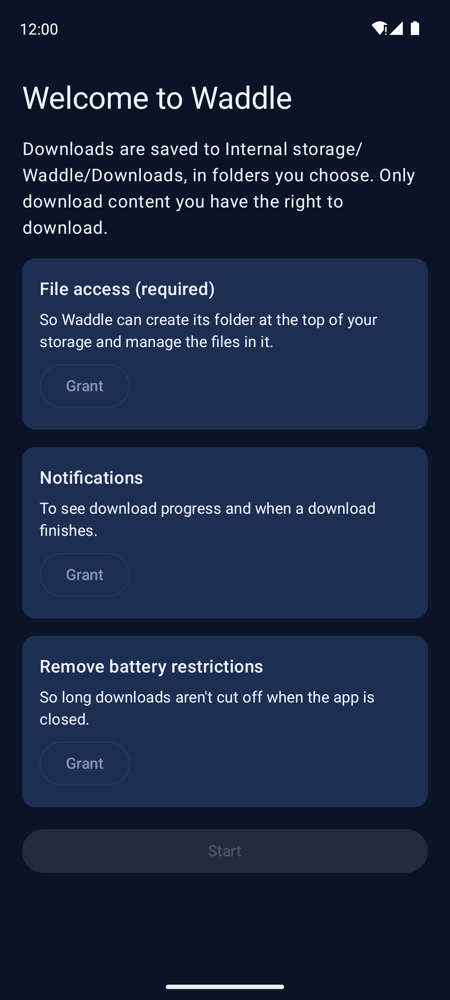
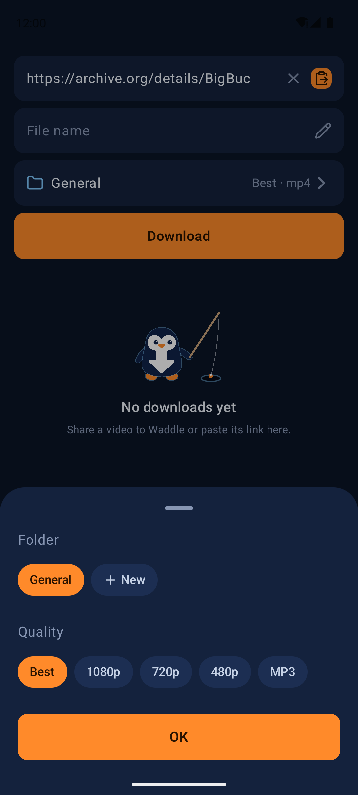
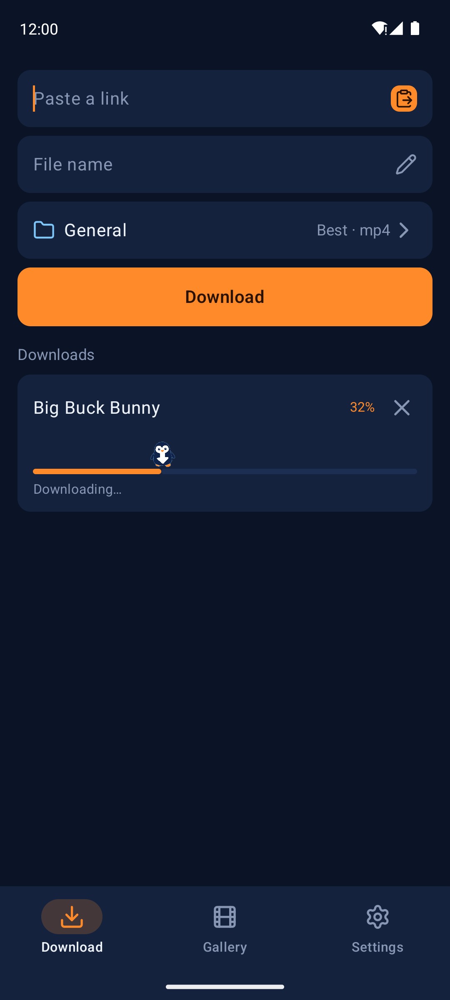
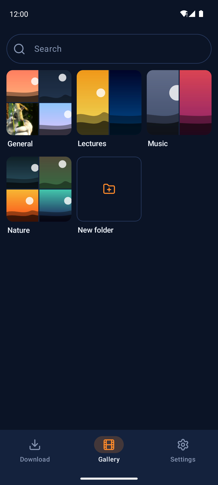
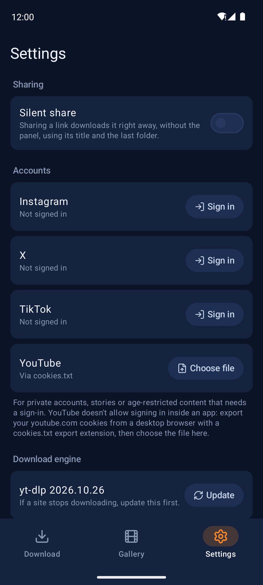

# Waddle

An Android app that downloads videos and audio from a shared or pasted link, powered by yt-dlp.

> **Download only content you have the right to download.** Respect copyright and each site's
> terms of service. Waddle is not affiliated with, endorsed by, or connected to any website it can
> download from. See [Disclaimer](#disclaimer).

## Screenshots

| Onboarding | Download | Downloads in progress |
| --- | --- | --- |
|  |  |  |

| Gallery | Settings |
| --- | --- |
|  |  |

Screenshots were taken on an emulator with generated demo pictures. The sample video is
[Big Buck Bunny](https://peach.blender.org/) (© Blender Foundation, CC BY 3.0).

## Features

- **Share to download.** Pick "Download with Waddle" in any app's share sheet. A small panel opens
  over the app you shared from; you can also paste a link inside Waddle.
- **Choices before each download:** file name (defaults to the video title), folder, and quality:
  Best, 1080p, 720p, 480p (mp4 video), or MP3 audio.
- **Clips.** Keep only a time range of a single video, set with a slider or typed as `m:ss`.
  The cut is exact to the second; the clip is re-encoded to get there.
- **Playlists and carousels.** Links with several videos list every entry with its thumbnail, so you
  can pick which ones to download. Private or deleted entries start unticked.
- **Silent share** (optional). Sharing a link downloads it straight away with its title, into the
  last folder and quality you used.
- **Background downloads** with a progress notification and a cancel button. Downloads run one at a
  time from a queue; failed or cancelled ones can be retried.
- **Gallery.** Folders shown as collages of their first files, a justified grid of thumbnails,
  search by file name or embedded title, and long-press menus to share, rename, move or delete.
  Several files can be selected at once.
- **Sign-in** for content that needs an account: Instagram, X and TikTok in an in-app browser
  page, YouTube through an imported `cookies.txt` file.
- **Download location** can be moved to any folder on internal storage; existing files move with it.
  Settings lists each folder's size.
- **Engine updates.** The bundled yt-dlp can be updated from Settings, and by default updates itself
  once a day (can be turned off).

Waddle can download from the sites yt-dlp supports. Site support depends on yt-dlp and changes
when sites change; it is not guaranteed for any particular site.

## Requirements

- **Android 11 (API 30) or newer.**
- **A 64-bit ARM device (arm64-v8a).** Release APKs contain only arm64-v8a native code, because each
  extra architecture adds another copy of the bundled Python and ffmpeg (about 80 MB per
  architecture). Almost every phone sold since 2017 is arm64. Debug builds also include x86_64 so
  they run on the Android emulator.
- **About 80 MB** for the APK, plus room for the engine it unpacks on first start and for your
  downloads.
- **Permissions:**
  - *All files access* (`MANAGE_EXTERNAL_STORAGE`), **required**. Waddle saves into a plain
    `Waddle` folder at the top of internal storage that any file manager and media app can see,
    reads that folder back for the gallery, and lets you move it, rename and delete files in it,
    and pick another download folder anywhere on internal storage. Scoped storage does not allow
    this for arbitrary folders.
  - *Notifications* (optional): download progress and finished/failed notices.
  - *Ignore battery optimizations* (optional): so the system does not stop long downloads.
  - *Internet* and *network state*: downloading.
  - *Foreground service (data sync)* and *wake lock*: running downloads in the background.

## Install

1. Download `Waddle-<version>.apk` from the [latest release](../../releases/latest). Each release
   also has a `.sha256` file to check the download.
2. Open the APK on your phone. Android asks you to allow installing apps from the browser or file
   manager you opened it with; allow it for that app.
3. Open Waddle and follow the onboarding screen.

Updates are installed the same way, over the existing app. Waddle is not on Google Play.

## Usage

1. **First start.** Grant *File access* (required). Notifications and the battery exemption are
   optional but recommended. Tap **Start**.
2. **Download from another app.** In a video app or browser, tap *Share* and choose
   **Download with Waddle**. The panel shows the video's title once it has looked at the link.
   - Tap the name field to type your own file name.
   - Tap the folder and quality row to pick a folder (or create a new one) and a quality.
   - For a single video, tap **Full length** to download only a clip.
   - For a playlist or carousel, tap the video count to choose which videos to download.
   - Tap **Download**. The panel closes and the download continues in the background.
3. **Download from inside Waddle.** On the **Download** tab, paste a link (the orange button pastes
   from the clipboard), set the same options and tap **Download**. The list below shows queued,
   running and finished downloads. Tap a finished one to open it, or **Try again** on a failed one.
4. **Gallery.** The **Gallery** tab shows your folders. Open one to see its files; tap a file to
   open it in your video or music player. Long-press a file for *Select*, *Share*, *Rename*,
   *Move to another folder* and *Delete*; long-press a folder to rename it, move its contents, or
   delete it. The search field searches every folder.
5. **Settings.**
   - *Silent share*: skip the panel when sharing.
   - *Accounts*: sign in to Instagram, X or TikTok, or load YouTube cookies (see below).
   - *Download engine*: shows the yt-dlp version; **Update** fetches the latest one.
     *Update automatically* turns the daily update on or off.
   - *Download location*: tap to choose another folder on internal storage; files are moved there.

### Signing in

Some content only downloads when you are signed in: private accounts you follow, stories,
age-restricted or members-only videos.

- **Instagram, X, TikTok:** Settings → Accounts → **Sign in** opens the site's own login page in
  the app. Sign in as usual, then tap **Done**.
- **YouTube** does not allow signing in inside apps. On a computer, export your `youtube.com`
  cookies with a browser extension that saves a Netscape-format `cookies.txt`, copy the file to
  your phone, then Settings → Accounts → YouTube → **Choose file**. Only the YouTube/Google lines of
  the file are kept.

YouTube cookies are only used for a download after YouTube asked for a sign-in, because yt-dlp
works better for public videos without them. For the other sites, if a saved session is rejected,
Waddle retries once signed out and tells you to sign in again.

Signing in to a third-party app can be against a site's terms and can get an account flagged or
restricted. Use an account you are willing to risk.

## Privacy and security

Waddle has no accounts, servers, analytics, ads or crash reporting of its own.

**What leaves the device:**

- **Links you download.** yt-dlp contacts the site of each link to read its details (when the
  panel opens or a link is pasted) and to download it.
- **Playlist thumbnails.** When a link has several videos, the thumbnails in the selection list
  are fetched straight from the image addresses the site reports.
- **Engine updates.** On app start, at most once every 24 hours (and whenever you tap **Update**),
  the bundled youtubedl-android library asks the GitHub API
  (`api.github.com/repos/yt-dlp/yt-dlp/releases/latest`) for the latest stable release of
  [yt-dlp](https://github.com/yt-dlp/yt-dlp) and, if it is newer, downloads the `yt-dlp` file from
  that GitHub release. The downloaded yt-dlp replaces the bundled one and runs inside the app, so this is code
  that changes outside the APK you installed. Turn it off under Settings → Download engine →
  *Update automatically*; you can still update by hand.
- **Your session cookies** for a site are sent only to that site, by yt-dlp, while downloading
  from it.

**What is stored where:**

| What | Where | Notes |
| --- | --- | --- |
| Downloads | `Internal storage/Waddle/Downloads/<folder>/` (or the folder you chose) | Visible to other apps; nothing is deleted when you uninstall Waddle. |
| Partial downloads | `Internal storage/Waddle/.tmp/` | Hidden from media apps by a `.nomedia` file. |
| Saved sign-ins | App-private storage, `files/cookies/<site>.txt` | Netscape cookie files, readable only by Waddle. |
| In-app browser data | App-private WebView storage | Cookies and site data from the sign-in pages. |
| Settings | App-private shared preferences | Last folder and quality, silent share, download location, update setting and time. |
| Thumbnail and metadata cache | App-private cache | Can be cleared at any time. |

Backups are disabled (`allowBackup="false"`), so none of the app-private data goes into Android
or Google backups.

**Sign-in details.** The sign-in page is the site's own page in an Android WebView, with JavaScript,
DOM storage and third-party cookies enabled because the login pages need them. Some sites refuse
sign-in from embedded browsers and detect them by the `; wv` and `Version/x.y` tokens in the user
agent; Waddle removes those two tokens and leaves the rest of the user agent unchanged. Your
password is typed into the site's page and is never read or stored by Waddle. When you tap
**Done**, Waddle reads the cookies the WebView holds for that site's domains (`instagram.com`;
`x.com` and `twitter.com`; `tiktok.com`) and saves them to the site's cookie file, but only if a
signed-in session cookie is present (`sessionid` for Instagram and TikTok, `auth_token` for X).
For each download, yt-dlp gets a temporary copy of that one site's file, which is deleted when the
run ends.

**Signing out and clearing data.** Settings → Accounts → **Sign out** deletes the site's cookie file
and expires the WebView's cookies for that site's domains. To remove everything Waddle stores
privately (all sign-ins, browser data, settings and caches), use Android Settings → Apps → Waddle →
Storage → **Clear storage**, or uninstall the app. Downloaded files stay in the `Waddle` folder
until you delete them.

## Limitations and known issues

- English only, dark theme only.
- arm64-v8a devices only for release builds.
- Internal storage only: the download folder cannot be on an SD card or USB drive.
- One download at a time.
- Photos are not downloaded: a post with only photos fails with "This post has no video".
- Channel and profile links are refused; share a video or a playlist link instead.
- With silent share, links with more than 20 videos are refused; paste them into Waddle to choose.
- Clips are re-encoded, which is slow for long clips on older phones.
- When a site changes, downloads from it can break until yt-dlp is updated.
- YouTube sign-in works only through an imported `cookies.txt`, and exported cookies expire.

## Troubleshooting

- **A site stopped working.** Settings → Download engine → **Update**, then try again.
- **"This content requires signing in."** Sign in to the site under Settings → Accounts.
- **"Your session looks invalid."** The site rejected the saved sign-in; sign out and sign in again.
- **Downloads stop when the screen is off or the app is closed.** Grant the battery exemption
  (onboarding, or Android Settings → Apps → Waddle → Battery → Unrestricted). Some manufacturers
  also have their own background limits for apps; allow Waddle there.
- **No progress notification.** Allow notifications for Waddle in Android settings.
- **"Only a folder on the device's internal storage can be chosen."** SD cards and other storage
  providers are not supported as download locations.
- **The APK does not install.** Check that the device runs Android 11 or newer and has a 64-bit
  ARM processor. If you installed a build signed with a different key before, uninstall it first.

## Build from source

Requirements: JDK 17 or newer (CI uses JDK 21) and the Android SDK with platform 37 (Android Studio
installs it, or the Gradle build downloads it when the SDK licenses are accepted). Point Gradle at
the SDK with `ANDROID_HOME` or a `local.properties` file containing `sdk.dir=...`.

```sh
./gradlew assembleDebug        # app/build/outputs/apk/debug/app-debug.apk
./gradlew testDebugUnitTest    # JVM unit tests
./gradlew lintDebug            # Android lint
./gradlew assembleRelease      # release APK (signed only when signing is configured, see below)
```

Debug builds use the same application ID as release builds, so they replace each other on a device.
They contain x86_64 code for the emulator, and Settings has a **Debug → Seed demo library** entry
that writes generated sample pictures into a few demo folders (no network), for screenshots and
testing the gallery. Neither is in release builds.

### Release signing

The release build reads its signing key from environment variables or Gradle properties (for
example in `~/.gradle/gradle.properties`, never in the repository):

| Name | Value |
| --- | --- |
| `ANDROID_KEYSTORE_PATH` | Path to the keystore file |
| `ANDROID_KEYSTORE_PASSWORD` | Keystore password |
| `ANDROID_KEY_ALIAS` | Key alias |
| `ANDROID_KEY_PASSWORD` | Key password |

Without them, `assembleRelease` produces `app-release-unsigned.apk`. A release build never falls
back to the debug key.

## Development

### Continuous integration

- `.github/workflows/ci.yml` builds the debug APK and runs the unit tests and lint on every push to
  `main` and on every pull request.
- `.github/workflows/release.yml` runs when a tag starting with `v` is pushed. It checks that the
  tag matches `versionName`, builds and signs the release APK, verifies the signature, and creates a
  GitHub release with `Waddle-<version>.apk` and its SHA-256 checksum.

### Setting up the signing secrets (maintainers)

1. Create a release keystore once and keep it, and its passwords, somewhere safe outside the
   repository. Every future update must be signed with the same key, or users have to uninstall
   before they can update.

   ```sh
   keytool -genkeypair -v -keystore waddle-release.jks -alias waddle \
     -keyalg RSA -keysize 4096 -validity 10000
   ```

2. Encode it as a single line of base64:

   ```sh
   base64 -w 0 waddle-release.jks > waddle-release.jks.b64     # Linux
   base64 -i waddle-release.jks -o waddle-release.jks.b64      # macOS
   ```

3. In the GitHub repository, open Settings → Secrets and variables → Actions and add these
   repository secrets (or use `gh secret set NAME`):

   | Secret | Value |
   | --- | --- |
   | `ANDROID_KEYSTORE_BASE64` | Contents of `waddle-release.jks.b64` |
   | `ANDROID_KEYSTORE_PASSWORD` | Keystore password |
   | `ANDROID_KEY_ALIAS` | Key alias (`waddle` in the example) |
   | `ANDROID_KEY_PASSWORD` | Key password |

4. Delete the `.b64` file. To release, set `versionCode` and `versionName` in
   `app/build.gradle.kts`, commit, then tag and push:

   ```sh
   git tag v0.2.0
   git push origin v0.2.0
   ```

The release workflow fails instead of publishing if the keystore secret is missing or the APK is
not signed.

### Project layout

| Path | What it holds |
| --- | --- |
| `app/src/main/java/.../engine` | yt-dlp/ffmpeg wrapper, link probing, quality, cookies |
| `app/src/main/java/.../download` | WorkManager download queue, worker and notifications |
| `app/src/main/java/.../storage` | Download folders, file operations, metadata and thumbnail caches |
| `app/src/main/java/.../share` | Share-sheet panel |
| `app/src/main/java/.../ui` | Compose screens, theme, penguin mascot |
| `app/src/debug`, `app/src/release` | Debug-only developer tools and their release stand-in |
| `app/src/test` | JVM unit tests |

## Disclaimer

Waddle is a general-purpose tool. You are responsible for what you download with it: download only
content you own or have permission to download, and follow copyright law and each site's terms of
service. Downloading may be against a site's terms even when the content is public.

Waddle is not affiliated with, endorsed by, or sponsored by YouTube, Google, Instagram, Meta, X,
TikTok, the yt-dlp project, or any other company or site named here; their names and trademarks
belong to their owners and are used only to describe compatibility.

The software is provided "as is", without warranty of any kind. Use it at your own risk; see the
license for details.

## License

Waddle is free software, licensed under the
[GNU General Public License v3.0 or later](LICENSE). Copyright (c) 2026 iefedev.

### Third-party software

The APK bundles and depends on:

| Component | License |
| --- | --- |
| [yt-dlp](https://github.com/yt-dlp/yt-dlp) | Unlicense |
| [youtubedl-android](https://github.com/JunkFood02/youtubedl-android) (bundles Python, yt-dlp and ffmpeg for Android) | GPL-3.0 |
| [FFmpeg](https://ffmpeg.org), in the GPL build shipped by youtubedl-android (includes x264) | GPL |
| [Python](https://www.python.org), as bundled by youtubedl-android | PSF License |
| [Lucide](https://lucide.dev) icons, via `com.composables:icons-lucide-android` | ISC (Lucide icons), MIT (composeicons wrapper) |
| AndroidX, Jetpack Compose, WorkManager, Kotlin coroutines | Apache-2.0 |

Because the APK includes GPL components, distributed builds of Waddle are covered by the GPL as a
whole, and the source for any build you distribute must be available under the same terms.
